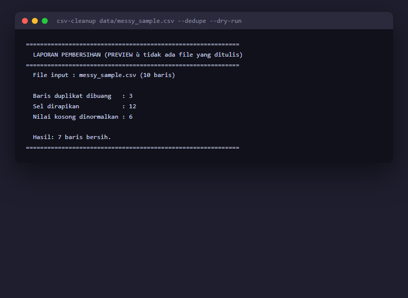

# csv-cleanup

[](https://github.com/muhammaddani/csv-cleanup/actions/workflows/ci.yml)
[](LICENSE)
[](https://www.python.org/)

Bersihkan file CSV yang berantakan dengan **satu perintah**.

## Pratinjau



Data mentah dari ekspor, formulir, atau sistem lama hampir selalu punya masalah
yang sama: baris duplikat, spasi berlebih, nilai kosong tak konsisten (`-`,
`N/A`, `null`), dan sel campur spasi. Membersihkannya secara manual menyiksa.
Alat ini melakukannya otomatis — dan **menunjukkan persis apa yang diubahnya**
sebelum menimpa apa pun.

## Masalah yang diselesaikan

| Masalah | Contoh | Yang dilakukan alat |
|---|---|---|
| Baris duplikat | baris yang sama muncul 2x | buang, sisakan satu |
| Spasi berlebih | `"  Budi  "` | jadi `"Budi"` |
| Nilai kosong tak konsisten | `-`, `N/A`, `null`, `NULL` | jadikan sel kosong |
| Sel campur spasi & tak teratur | `"  Jakarta , Indonesia "` | dirapikan |
| Karakter tersembunyi | spasi tak terlihat (NBSP, tab) | diganti spasi biasa |

## Prinsip: aman secara bawaan

- **Mode preview** (`--dry-run`) adalah teman terbaikmu: ia menunjukkan berapa
  banyak baris/sel yang akan berubah **tanpa menulis apa pun**.
- Secara bawaan, hasil ditulis ke **file baru** (`bersih.csv`), bukan menimpa
  aslinya.
- Laporan jelas: berapa yang dibuang, berapa yang dirapikan.

## Instalasi

```bash
pip install .
```

## Cara pakai

```bash
# Lihat dulu apa yang akan diubah (aman, tidak menulis apa-apa)
python -m csv_cleanup data.csv --dry-run

# Bersihkan dan tulis ke file baru
python -m csv_cleanup data.csv -o bersih.csv

# Buang duplikat saja, berdasarkan kolom tertentu
python -m csv_cleanup data.csv --dedupe-by email -o bersih.csv

# Rapikan hanya kolom tertentu
python -m csv_cleanup data.csv --trim-columns nama,kota -o bersih.csv
```

## Contoh keluaran

```
============================================================
  LAPORAN PEMBERSIHAN
============================================================
  File input : data.csv (12 baris)
  File output: bersih.csv

  Baris duplikat dibuang : 3
  Sel dirapikan           : 7
  Nilai kosong dinormalkan: 2

  Hasil: 9 baris bersih.
============================================================
```

## Kode keluar

| Kode | Arti |
|------|------|
| `0`  | Berhasil |
| `1`  | Terjadi kesalahan (file tidak ada, format tidak valid, dll.) |

## Menjalankan test

```bash
python -m pytest -v
```

## Struktur proyek

```
csv-cleanup/
├── src/csv_cleanup/
│   ├── __init__.py
│   ├── cleaner.py       # logika pembersihan (fungsi murni)
│   └── cli.py           # antarmuka baris perintah
├── tests/
│   └── test_cleaner.py
├── data/
│   └── messy_sample.csv # data contoh yang kotor
├── .github/workflows/ci.yml
├── pyproject.toml
├── LICENSE
├── CHANGELOG.md
└── README.md
```

## Lisensi

MIT — lihat [LICENSE](LICENSE).